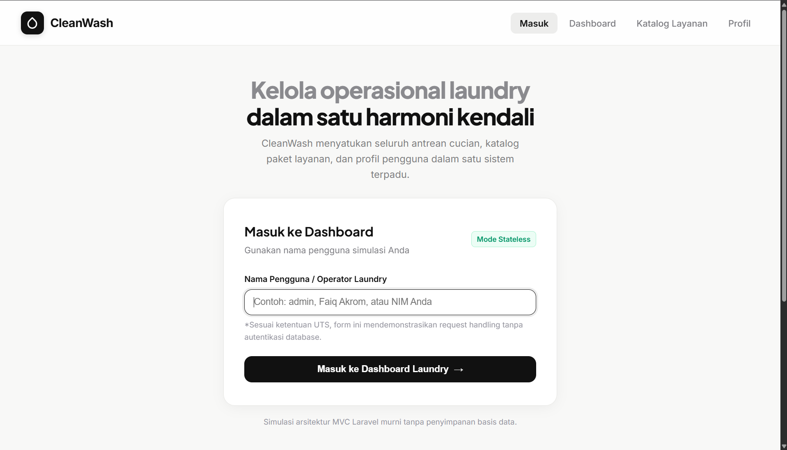
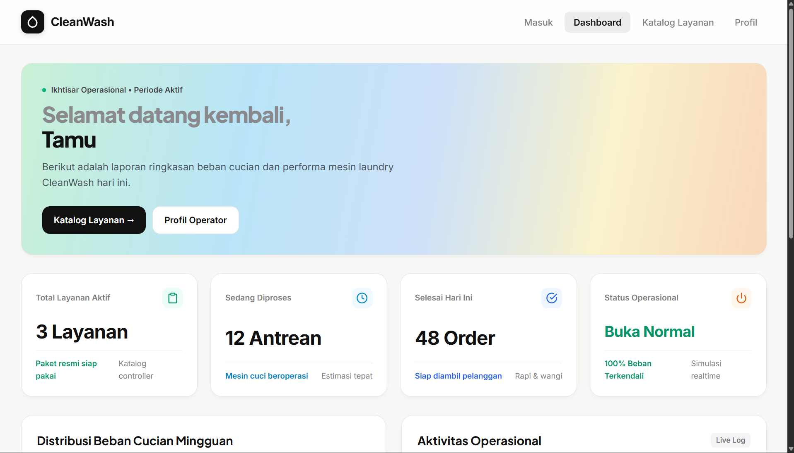
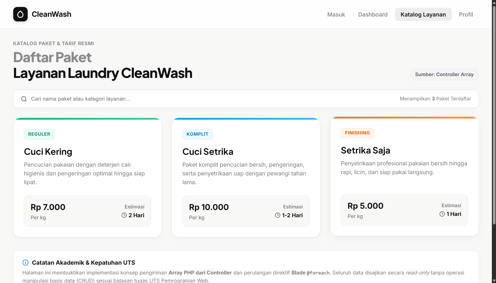
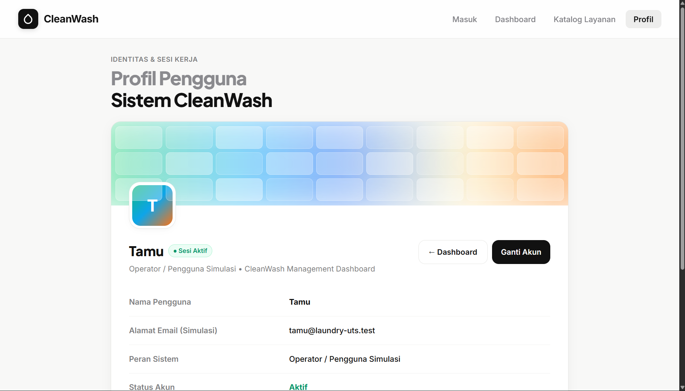

# UTS Pemrograman Web 2026 — Laundry Management Dashboard (CleanWash)

Aplikasi web simulasi dashboard pengelolaan laundry berbasis **Laravel Murni**, arsitektur **MVC**, **Blade Templating Engine**, dan **Vanilla CSS**.

---

## Penjelasan Singkat

**CleanWash** adalah aplikasi web simulasi dashboard pengelolaan laundry modern yang dibangun untuk memenuhi tugas Ujian Tengah Semester (UTS) Pemrograman Web 2026. Aplikasi ini berfokus pada penerapan fundamental arsitektur web modern tanpa melibatkan kompleksitas basis data.

- **Tema Proyek:** Simulasi Dashboard Pengelolaan Usaha Laundry (CleanWash).
- **Teknologi Utama:** 
  - Framework: **Laravel Murni** (tanpa starter kit seperti Breeze/Jetstream/Filament).
  - Pola Arsitektur: **MVC (Model-View-Controller)** murni di mana data disuplai melalui array PHP terstruktur pada Controller.
  - Template Engine: **Blade** (memanfaatkan `@extends`, `@section`, `@yield`, `@include`, `@foreach`, dan Blade Component `<x-component>`).
  - Styling: **CSS Murni (Vanilla CSS)** dengan estetika modern, responsif, dan bebas dependensi luar.
- **Karakteristik Sistem:** Bersifat *stateless*, tanpa koneksi database, tanpa operasi CRUD, serta mendemonstrasikan pengiriman data pengguna antar-halaman melalui HTTP Request Parameter.

---

## Screenshot Antarmuka

Berikut adalah dokumentasi tampilan antarmuka aplikasi pada setiap halaman utama:

### 1. Halaman Login
Halaman awal untuk memasukkan nama pengguna/operator guna simulasi request parameter.


### 2. Halaman Dashboard
Menampilkan sapaan personal dinamis, ringkasan kartu metrik performa laundry, dan visualisasi distribusi beban mingguan.


### 3. Halaman Pengelolaan Layanan
Menampilkan katalog paket layanan laundry (Cuci Kering, Cuci Setrika, Setrika Saja) yang dirender dari controller menggunakan `@foreach`.


### 4. Halaman Profil
Menampilkan identitas pengguna yang diteruskan melalui parameter request beserta simulasi detail akun.


---

## Ringkasan Fitur & 9 File Wajib

1. `routes/web.php` — Definisi rute GET login, dashboard, pengelolaan, dan profile.
2. `app/Http/Controllers/PageController.php` — Single controller pemroses request dan penyedia array statis.
3. `resources/views/layouts/app.blade.php` — Master template layout (`@yield`, `@include`, `<x-component>`).
4. `resources/views/components/navbar.blade.php` — Komponen navigasi atas dengan indikator aktif & badge user.
5. `resources/views/components/footer.blade.php` — Komponen footer hak cipta.
6. `resources/views/login.blade.php` — Form simulasi login pengirim nama via GET query parameter.
7. `resources/views/dashboard.blade.php` — Sapaan personal dan ringkasan metrik laundry statis.
8. `resources/views/pengelolaan.blade.php` — Katalog layanan laundry (Cuci Kering, Cuci Setrika, Setrika Saja) dirender via `@foreach`.
9. `resources/views/profile.blade.php` — Informasi profil pengguna berdasarkan request parameter.

---

## Cara Menjalankan Proyek di Komputer Lokal

Ikuti langkah-langkah berikut untuk mengkloning dan menjalankan proyek ini di lingkungan lokal Anda:

```bash
# 1. Kloning repositori dari GitHub
git clone https://github.com/FaiqAkrom/UTS_PWEB_252410102042.git

# 2. Masuk ke direktori proyek
cd UTS_PWEB_252410102042

# 3. Pasang seluruh dependensi PHP via Composer
composer install

# 4. Salin file environment konfigurasi
# Untuk Linux / macOS:
cp .env.example .env
# Untuk Windows (Command Prompt / PowerShell):
copy .env.example .env

# 5. Buat application encryption key
php artisan key:generate

# 6. Jalankan server pengembangan lokal Laravel
php artisan serve
```

Setelah server aktif, buka peramban web dan akses alamat:
👉 **[http://127.0.0.1:8000](http://127.0.0.1:8000)**
