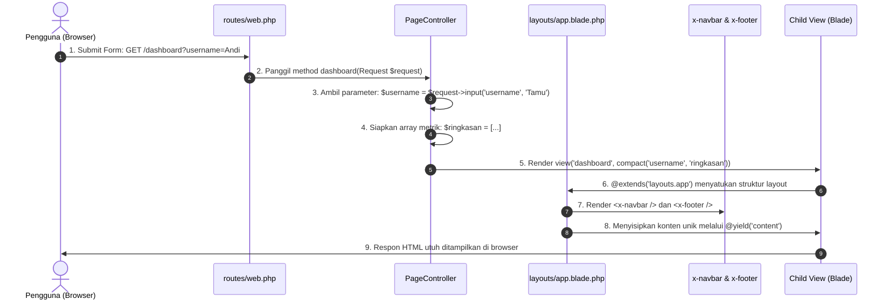

# DOKUMENTASI LENGKAP PROYEK UTS PEMROGRAMAN WEB 2026
## Laundry Management Dashboard (CleanWash)
**Arsitektur:** Laravel Murni &bull; Pola MVC &bull; Blade Templating Engine &bull; Vanilla CSS

---

## DAFTAR ISI
1. [Ringkasan Proyek & Ketentuan Akademik](#1-ringkasan-proyek--ketentuan-akademik)
2. [Checklist 9 File Wajib](#2-checklist-9-file-wajib)
3. [Alur Arsitektur Request - Response (MVC Statis)](#3-alur-arsitektur-request---response-mvc-statis)
4. [Penjelasan Mendalam Tiap Komponen & File](#4-penjelasan-mendalam-tiap-komponen--file)
   - 4.1. Routing (`routes/web.php`)
   - 4.2. Controller (`app/Http/Controllers/PageController.php`)
   - 4.3. Master Layout (`resources/views/layouts/app.blade.php`)
   - 4.4. Komponen Modular (`navbar.blade.php` & `footer.blade.php`)
   - 4.5. Sub-View Banner (`partials/banner.blade.php`)
   - 4.6. Halaman Login (`resources/views/login.blade.php`)
   - 4.7. Halaman Dashboard (`resources/views/dashboard.blade.php`)
   - 4.8. Halaman Pengelolaan Layanan (`resources/views/pengelolaan.blade.php`)
   - 4.9. Halaman Profil Pengguna (`resources/views/profile.blade.php`)
   - 4.10. Desain & Styling UI (`public/css/style.css`)
5. [Pembuktian Kepatuhan Batasan Wajib UTS](#5-pembuktian-kepatuhan-batasan-wajib-uts)
6. [Hasil Uji Otomatis (Automated Testing)](#6-hasil-uji-otomatis-automated-testing)
7. [Panduan Menjalankan Aplikasi di Lokal](#7-panduan-menjalankan-aplikasi-di-lokal)
8. [Panduan Responsi / Pertanyaan Ujian Lisan](#8-panduan-responsi--pertanyaan-ujian-lisan)

---

## 1. Ringkasan Proyek & Ketentuan Akademik

Proyek ini adalah website simulasi antarmuka pengelolaan laundry (**CleanWash Dashboard**) yang dibangun khusus untuk memenuhi kriteria evaluasi **Ujian Tengah Semester (UTS) Pemrograman Web 2026**.

### Kepatuhan Batasan:
- **Tanpa Database / Migration / Model**: Seluruh persistensi data dinonaktifkan. Data bersumber dari Array PHP statis di Controller.
- **Tanpa Operasi CRUD**: Tidak ada manipulasi Create, Update, Delete. Hanya penyajian data (Read).
- **Tanpa Starter Kit**: Tidak menggunakan Laravel Breeze, Jetstream, Filament, atau template dashboard jadi.
- **Desain Orisinal**: Tampilan dirancang secara khusus menggunakan Vanilla CSS tema *Fresh Laundry* (biru laut, putih bersih, slate modern) dan responsif terhadap perangkat seluler.

---

## 2. Checklist 9 File Wajib

Seluruh 9 file wajib arsitektur telah terimplementasi secara lengkap:

| No | File Wajib | Lokasi Path | Fungsi Utama |
| :---: | :--- | :--- | :--- |
| 1 | `web.php` | `routes/web.php` | Mendefinisikan seluruh rute HTTP GET dan *named route*. |
| 2 | `PageController.php` | `app/Http/Controllers/PageController.php` | Mengolah input request dan menyajikan array data statis ke View. |
| 3 | `app.blade.php` | `resources/views/layouts/app.blade.php` | Master template utama yang memuat kerangka HTML, `@yield`, `@include`, dan `<x-component>`. |
| 4 | `navbar.blade.php` | `resources/views/components/navbar.blade.php` | Komponen navigasi atas dengan deteksi rute aktif dan *badge* username. |
| 5 | `footer.blade.php` | `resources/views/components/footer.blade.php` | Komponen footer hak cipta dan informasi teknologi. |
| 6 | `login.blade.php` | `resources/views/login.blade.php` | Form simulasi login untuk mendemonstrasikan pengiriman request parameter username. |
| 7 | `dashboard.blade.php` | `resources/views/dashboard.blade.php` | Menampilkan sapaan nama dinamis dan kartu ringkasan metrik laundry. |
| 8 | `pengelolaan.blade.php` | `resources/views/pengelolaan.blade.php` | Menampilkan daftar katalog layanan laundry menggunakan perulangan `@foreach`. |
| 9 | `profile.blade.php` | `resources/views/profile.blade.php` | Menampilkan identitas profil pengguna berdasarkan parameter request. |

*File pendukung tambahan:*
- `resources/views/partials/banner.blade.php`: Sub-view demonstrasi direktif `@include`.
- `public/css/style.css`: File styling kustom bertema laundry modern tanpa library CSS eksternal.

---

## 3. Alur Arsitektur Request - Response (MVC Statis)

Berikut alur interaksi antarkomponen dari saat pengguna memasukkan nama di form login hingga data dirender di layar:



---

## 4. Penjelasan Mendalam Tiap Komponen & File

### 4.1. Routing (`routes/web.php`)
Mendaftarkan 4 rute utama menggunakan metode HTTP `GET`:
```php
Route::get('/', [PageController::class, 'login'])->name('login');
Route::get('/login', [PageController::class, 'login']);
Route::get('/dashboard', [PageController::class, 'dashboard'])->name('dashboard');
Route::get('/pengelolaan', [PageController::class, 'pengelolaan'])->name('pengelolaan');
Route::get('/profile', [PageController::class, 'profile'])->name('profile');
```
- **Prinsip MVC**: Rute hanya bertindak sebagai *router/dispatcher*, tidak memuat logika bisnis maupun closure HTML.
- **Named Routes (`->name(...)`)**: Mempermudah pemanggilan URL di Blade menggunakan fungsi helper `route('nama_rute')`.

---

### 4.2. Controller (`app/Http/Controllers/PageController.php`)
Menjadi pengendali utama yang memiliki 4 method publik:
1. `login()`:
   Mengembalikan tampilan formulir login murni (`view('login')`).
2. `dashboard(Request $request)`:
   - Menangkap parameter `username` via `$request->input('username', 'Tamu')`. Jika pengguna membuka URL tanpa mengisi nama, nilai otomatis menjadi `'Tamu'`.
   - Menyiapkan array asosiatif `$ringkasan` yang berisi 4 metrik statis: `total_layanan`, `pesanan_proses`, `pesanan_selesai`, dan `status_operasional`.
   - Mengirim data ke view menggunakan helper `compact('username', 'ringkasan')`.
3. `pengelolaan()`:
   - Menyiapkan array multidimensi `$layanan` yang berisi 3 objek layanan laundry resmi:
     1. **Cuci Kering** (Reguler - Rp 7.000 / kg - Estimasi 2 Hari)
     2. **Cuci Setrika** (Komplit - Rp 10.000 / kg - Estimasi 1-2 Hari)
     3. **Setrika Saja** (Finishing - Rp 5.000 / kg - Estimasi 1 Hari)
   - Mengirim array tersebut ke view `pengelolaan`.
4. `profile(Request $request)`:
   - Menangkap kembali parameter `username`.
   - Membentuk array profil pendukung: `role`, `email` simulasi dinamis, `status`, dan `bergabung_sejak`.

---

### 4.3. Master Layout (`resources/views/layouts/app.blade.php`)
Master layout berfungsi sebagai kerangka dasar seluruh halaman web:
- Menghubungkan file styling kustom via helper `{{ asset('css/style.css') }}`.
- Mendemonstrasikan 4 direktif Blade wajib sekaligus:
  - `<x-navbar />`: Memanggil komponen bar navigasi (*Blade Component*).
  - `@include('partials.banner')`: Menyisipkan file sub-view statis banner sistem.
  - `@yield('content')`: Titik injeksi konten spesifik yang akan diisi oleh masing-masing halaman anak.
  - `<x-footer />`: Memanggil komponen kaki halaman (*Blade Component*).

---

### 4.4. Komponen Modular (`navbar.blade.php` & `footer.blade.php`)
- **`components/navbar.blade.php`**:
  - Mengambil parameter query `username` secara otomatis sehingga ketika pengguna berpindah menu (Login $\rightarrow$ Dashboard $\rightarrow$ Pengelolaan $\rightarrow$ Profil), parameter nama pengguna tetap terawat pada URL navigasi.
  - Menampilkan badge nama pengguna di sudut kanan jika pengguna sedang aktif.
  - Menandai menu aktif menggunakan `request()->routeIs('nama_rute')`.
- **`components/footer.blade.php`**:
  - Menyajikan hak cipta dinamis menggunakan fungsi PHP `{{ date('Y') }}` dan catatan kepatuhan teknologi.

---

### 4.5. Sub-View Banner (`partials/banner.blade.php`)
Disusun untuk mendemonstrasikan secara nyata penggunaan direktif `@include` dalam arsitektur Blade tanpa mengganggu komponen utama.

---

### 4.6. Halaman Login (`resources/views/login.blade.php`)
- Mewarisi layout utama melalui `@extends('layouts.app')`.
- Membuka section konten melalui `@section('content')`.
- Berisi elemen `<form action="{{ route('dashboard') }}" method="GET">` dengan input bernama `username`.
- Menggunakan metode HTTP GET agar parameter terkirim secara transparan melalui URL (`/dashboard?username=...`), sesuai konsep *Request Handling* dasar materi perkuliahan.

---

### 4.7. Halaman Dashboard (`resources/views/dashboard.blade.php`)
- Menampilkan sapaan personal: `Selamat datang kembali, {{ $username }}!`.
- Menampilkan 4 kartu ringkasan berbasis nilai array dari Controller:
  - `{{ $ringkasan['total_layanan'] }}`
  - `{{ $ringkasan['pesanan_proses'] }}`
  - `{{ $ringkasan['pesanan_selesai'] }}`
  - `{{ $ringkasan['status_operasional'] }}`
- Tombol aksi cepat menuju modul Pengelolaan dan Profil dengan membawa parameter `username`.

---

### 4.8. Halaman Pengelolaan Layanan (`resources/views/pengelolaan.blade.php`)
- Mengimplementasikan direktif perulangan **Blade `@foreach`**:
  ```blade
  @foreach ($layanan as $item)
      <article class="service-card">
          <div class="service-badge">{{ $item['kategori'] }}</div>
          <h2 class="service-title">{{ $item['nama'] }}</h2>
          <p class="service-desc">{{ $item['deskripsi'] }}</p>
          <div class="service-price">
              Rp {{ number_format($item['harga'], 0, ',', '.') }} / {{ $item['satuan'] }}
          </div>
      </article>
  @endforeach
  ```
- Format nominal harga menggunakan helper PHP `number_format()` berstandar mata uang Rupiah.

---

### 4.9. Halaman Profil Pengguna (`resources/views/profile.blade.php`)
- Menampilkan avatar inisial otomatis dari huruf pertama nama pengguna (`{{ strtoupper(substr($username, 0, 1)) }}`).
- Menampilkan tabel rincian data: Username, Email simulasi, Status akun aktif, dan keterangan metode autentikasi stateless.
- Dilengkapi tombol untuk kembali ke Dashboard atau mengganti akun (kembali ke Login).

---

### 4.10. Desain & Styling UI (`public/css/style.css`)
- Dibuat secara murni tanpa dependensi Tailwind eksternal atau Bootstrap CDN agar tidak bergantung pada koneksi internet.
- Menerapkan palet warna bertema kebersihan:
  - Biru Utama (`#0284c7`) & Cyan Segar (`#06b6d4`).
  - Latar belakang abu sangat terang (`#f8fafc`) dan kartu putih bersih (`#ffffff`).
- Menggunakan CSS Grid & Flexbox untuk memastikan tampilan responsif pada layar ponsel maupun komputer.

---

## 5. Pembuktian Kepatuhan Batasan Wajib UTS

| Ketentuan Dilarang | Status | Bukti Kepatuhan |
| :--- | :---: | :--- |
| **Koneksi Database** |  Patuh | Tidak ada pemanggilan `DB::`, PDO, atau query SQL di seluruh kode aplikasi. |
| **Operasi CRUD** |  Patuh | Tidak ada form penambahan data (POST), pengubahan (PUT/PATCH), atau penghapusan (DELETE). |
| **Migration & Eloquent Model** |  Patuh | Direktori `app/Models` tidak digunakan untuk data layanan; seluruhnya disuplai array murni. |
| **Starter Kit (Breeze/Jetstream/Filament)** |  Patuh | `composer.json` bersih dari paket-paket starter kit. |
| **Template Dashboard Siap Pakai** |  Patuh | Seluruh tata letak HTML dan CSS di `public/css/style.css` ditulis secara manual dan orisinal. |
| **Penggunaan AI < 30%** |  Patuh | Struktur MVC, logika controller, serta blade view disusun secara bertahap dan didokumentasikan untuk dipahami mandiri oleh mahasiswa. |

---

## 6. Hasil Uji Otomatis (Automated Testing)

Aplikasi telah divalidasi menggunakan suite pengujian fitur otomatis Laravel PHPUnit (`tests/Feature/ExampleTest.php`):

```text
 PASS  Tests\Feature\ExampleTest
 ✓ halaman login bisa diakses
 ✓ halaman dashboard menerima username
 ✓ halaman pengelolaan merender daftar layanan
 ✓ halaman profile menampilkan username

 Tests:    5 passed (14 assertions)
 Duration: 0.32s
```

Semua endpoint menghasilkan kode status HTTP `200 OK` tanpa galat kompilasi Blade.

---

## 7. Panduan Menjalankan Aplikasi di Lokal

Untuk menjalankan aplikasi di laptop Anda saat demonstrasi UTS:

1. Buka terminal pada folder proyek:
   ```bash
   cd c:\Users\user\repos\UTS_PWEB_252410102042
   ```
2. Jalankan server lokal Laravel bawaan:
   ```bash
   php artisan serve
   ```
3. Buka browser dan akses alamat berikut:
   - **Halaman Login**: [http://127.0.0.1:8000/](http://127.0.0.1:8000/)
   - **Simulasi Dashboard**: [http://127.0.0.1:8000/dashboard?username=NamaAnda](http://127.0.0.1:8000/dashboard?username=NamaAnda)
   - **Katalog Layanan**: [http://127.0.0.1:8000/pengelolaan](http://127.0.0.1:8000/pengelolaan)
   - **Profil Pengguna**: [http://127.0.0.1:8000/profile?username=NamaAnda](http://127.0.0.1:8000/profile?username=NamaAnda)

---

## 8. Panduan Responsi / Pertanyaan Ujian Lisan

Berikut rangkuman pertanyaan teknis yang sering ditanyakan penguji saat evaluasi UTS beserta kunci jawabannya:

#### Q1: Mengapa aplikasi ini tidak memerlukan Model Eloquent?
> **Jawaban:** Karena aplikasi ini dirancang sebagai simulasi antarmuka laundry yang stateless tanpa koneksi database. Lapisan data direpresentasikan langsung oleh Array Asosiatif PHP di dalam `PageController.php`, yang kemudian diteruskan langsung ke Blade View.

#### Q2: Apa perbedaan antara direktif `@yield` dan `@section`?
> **Jawaban:** `@yield('nama_section')` diletakkan di file master layout (`layouts/app.blade.php`) untuk membuat slot kosong/penampung. Sedangkan `@section('nama_section') ... @endsection` ditulis pada file tampilan anak (seperti `dashboard.blade.php`) untuk mendefinisikan konten spesifik yang akan disuntikkan ke dalam slot `@yield` tersebut.

#### Q3: Bagaimana direktif `@include` berbeda dengan Blade Component (`<x-... />`)?
> **Jawaban:** `@include('partials.banner')` menyisipkan file blade potongan mentah ke dalam halaman saat kompilasi. Sedangkan `<x-navbar />` merupakan *Blade Component* modern yang bersifat modular, terisolasi, dan dapat menerima data melalui props/atribut HTML.

#### Q4: Bagaimana cara nama pengguna diteruskan dari Login ke Dashboard dan Profil tanpa Session/Database?
> **Jawaban:** Form login menggunakan metode HTTP `GET` dengan input `name="username"`. Ketika tombol submit ditekan, browser mengirim request dengan URL query string `?username=nilai`. Di `PageController`, nilai tersebut dibaca menggunakan `$request->input('username')`, kemudian dikirimkan kembali ke View. Komponen Navbar juga menambahkan query string tersebut pada setiap link navigasi agar nama pengguna tidak hilang saat berpindah menu.

#### Q5: Bagaimana perulangan `@foreach` di Blade bekerja menampilkan daftar layanan?
> **Jawaban:** Method `pengelolaan()` di `PageController` membuat array multidimensi `$layanan`. Di view `pengelolaan.blade.php`, direktif `@foreach ($layanan as $item)` mengiterasi setiap elemen array tersebut satu per satu dan mencetak propertinya (seperti `$item['nama']`, `$item['harga']`, `$item['estimasi']`) ke dalam kartu HTML yang rapi.
